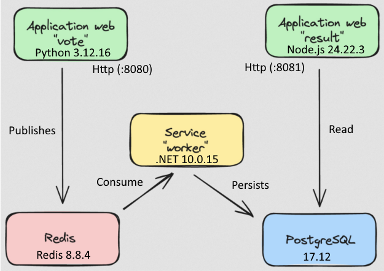

# 3DOKR - Distributed Voting Application

A modernized, secure, and production-ready containerized microservices voting application

---

## Table of Contents

- [1. Project Overview](#1-project-overview)
- [2. Architecture & Network Topology](#2-architecture--network-topology)
  - [2.1 High-Level Architecture Diagram](#21-high-level-architecture-diagram)
  - [2.2 Network Isolation Strategy](#22-network-isolation-strategy)
  - [2.3 Services Breakdown](#23-services-breakdown)
- [3. Quick Start Guide](#3-quick-start-guide)
  - [3.1 Prerequisites](#31-prerequisites)
  - [3.2 Secrets Setup](#32-secrets-setup)
  - [3.3 Running the Application](#33-running-the-application)
  - [3.4 Accessing the Services](#34-accessing-the-services)
  - [3.5 Stopping the project](#35-stopping-the-project)
- [4. Key Technical Choices & Production Best Practices](#4-key-technical-choices--production-best-practices)
  - [4.1 Security & Least Privilege (Non-Root Execution)](#41-security--least-privilege-non-root-execution)
  - [4.2 Native Docker Compose Secrets Management](#42-native-docker-compose-secrets-management)
  - [4.3 Dual-Tier Network Isolation](#43-dual-tier-network-isolation-internal-true)
  - [4.4 Multi-Stage Build and minimal images](#44-multi-stage-build-and-minimal-images)
  - [4.5 Healthchecks & Deterministic Startup Order](#45-healthchecks--deterministic-startup-order)
  - [4.6 Data Persistence & Resource Quotas](#46-data-persistence--resource-quotas)
  - [4.7 Vulnerability Scanning & Risk Assessment (Docker Scout)](#47-vulnerability-scanning--risk-assessment-docker-scout)
- [5. Modernization & LTS Upgrades](#5-modernization--lts-upgrades)
  - [5.1 Runtime & Framework Upgrades](#51-runtime--framework-upgrades)
  - [5.2 Codebase Refactoring](#52-codebase-refactoring)
- [6. Advanced Optimization: Golang Worker (Bonus)](#6-advanced-optimization-golang-worker-bonus)
  - [6.1 Motivation & Implementation](#61-motivation--implementation)
  - [6.2 Benchmark & Resource Comparison](#62-benchmark--resource-comparison)
  - [6.3 Testing the Go Worker Branch](#63-testing-the-go-worker-branch)
- [7. Git Workflow & Conventional Commits](#7-git-workflow--conventional-commits)

---

## 1. Project Overview

The **3DOKR** application is a distributed voting system composed of five microservices:

1. **`vote`**: A Python/Flask web frontend allowing users to cast votes between two options ("Cats" vs "Dogs").
2. **`redis`**: An in-memory queue collecting submitted votes.
3. **`worker`**: A backend worker service (.NET 10 on `main`, Golang on `feat/golang-worker`) that get votes from Redis and persists them into PostgreSQL.
4. **`db`**: A PostgreSQL database storing the final vote.
5. **`result`**: A Node.js web frontend displaying live voting results updated in real time.

---

## 2. Architecture & Network Topology

### 2.1 High-Level Architecture Diagram



### 2.2 Network Isolation Strategy

The application architecture enforces strict network zoning into two distinct tiers:

- **`front-tier` (Bridge network)**:
  - Accessible from the host only (127.0.0.1) via published ports (`8080` for `vote`, `8081` for `result`).
  - Contains only public-facing services that require browser interactions.
- **`back-tier` (Isolated internal network, `internal: true`)**:
  - Contains databases and backend consumers (`redis`, `db`, `worker`, `result`).
  - **internal: true**: Services on `back-tier` cannot initiate outgoing connections to the internet or host network.
  - Prevents external attacks, unauthorized database dumps, and potential data exfiltration.

```
+--------------------------------------------------------------------------+
| HOST / PUBLIC NETWORK                                                    |
|        :8080                                           :8081             |
+----------|-----------------------------------------------|---------------+
           |                                               |
+----------v-----------------------------------------------v---------------+
| FRONT-TIER NETWORK                                                       |
|   +---------------+                             +---------------+        |
|   |     vote      |                             |    result     |        |
|   +-------|-------+                             +-------|-------+        |
+-----------|---------------------------------------------|----------------+
            |                                             |
+-----------|---------------------------------------------|----------------+
| BACK-TIER NETWORK (internal: true - NO INTERNET ACCESS) |                |
|           |                                             |                |
|   +-------v-------+      +---------------+      +-------v-------+        |
|   |     redis     | ---> |    worker     | ---> |      db       |        |
|   +---------------+      +---------------+      +---------------+        |
+--------------------------------------------------------------------------+
```

### 2.3 Services Breakdown

| Service | Technology | Published Port | Networks | Non-Root User | Healthcheck |
| :--- | :--- | :--- | :--- | :--- | :--- |
| **`vote`** | Python 3.12.16 / Flask | `127.0.0.1:8080:8080` | `front-tier`, `back-tier` | `appuser` (10001) | HTTP GET `/` |
| **`result`** | Node.js 24.22.3 / Express | `127.0.0.1:8081:8888` | `front-tier`, `back-tier` | `node` (1000) | HTTP GET `/` |
| **`worker`** | .NET 10.0.15 | None (Internal) | `back-tier` | `app` (1000) | File heartbeat `/tmp/healthy` |
| **`redis`** | Redis 8.8.4 (Alpine) | None (Internal) | `back-tier` | `redis` (default) | `redis-cli ping` |
| **`db`** | PostgreSQL 17.12 (Alpine) | None (Internal) | `back-tier` | `postgres` (default) | `pg_isready -U postgres` |

---

## 3. Quick Start Guide

### 3.1 Prerequisites

- [Docker Engine](https://docs.docker.com/engine/install/)
- [Docker Compose](https://docs.docker.com/compose/) 

### 3.2 Secrets Setup

Ensure the PostgreSQL password secret file exists at `secrets/db_password.txt`. If it does not exist, generate it:

```bash
mkdir -p secrets
echo "your_db_password" > secrets/db_password.txt
```
Ensure the .env file also exist at the root directory of the project. If not generate it : 

```bash
cp .env.example .env
```

- **Note**: The `secrets/` directory and the `.env` file are excluded from version control via `.gitignore` to avoid credential leaks.

### 3.3 Running the Application

Go into the project directory : 

```bash
cd ./3DOKR/
```

Build and start the complete stack in detached mode:

```bash
docker compose up -d --build
```

After a few seconds, verify that all five containers start up cleanly and transition to the `(healthy)` state:

```bash
docker compose ps
```

Expected output:
```text
NAME             IMAGE                       STATUS                    PORTS
3dokr-db-1       postgres:17.12-alpine3.23   Up (healthy)              5432/tcp
3dokr-redis-1    redis:8.8.4-alpine3.23      Up (healthy)              6379/tcp
3dokr-result-1   3dokr-result                Up (healthy)              127.0.0.1:8081->8888/tcp
3dokr-vote-1     3dokr-vote                  Up (healthy)              127.0.0.1:8080->8080/tcp
3dokr-worker-1   3dokr-worker                Up (healthy)              
```

### 3.4 Accessing the Services

- **Voting Interface**: Open http://localhost:8080 to cast a vote.
- **Live Results Dashboard**: Open http://localhost:8081 to view real-time tally updates.

### 3.5 Stopping the project

To stop all containers while preserving database volume data:

```bash
docker compose down
```

To stop containers and delete database persistent volumes:

```bash
docker compose down -v
```

---

## 4. Key Technical Choices & Production Best Practices

### 4.1 Security & Least Privilege (Non-Root Execution)

Running containers as `root` inside the container increases the risk of host privilege escalation in the event of a container breakout. All services run under dedicated non-root users:
- **`vote`**: Creates and runs under `appuser:appgroup` (UID/GID `10001:10001`).
- **`result`**: Runs under the native unprivileged `node` user (UID `1000`).
- **`worker`**: Runs under unprivileged `app` user (UID `1000`) on .NET, or `10001:10001` on Go.
- **`db` & `redis`**: Run under official system users (`postgres`, `redis`).

### 4.2 Native Docker Compose Secrets Management

Cleartext database credentials in environment variables (`POSTGRES_PASSWORD`) can be inspected by any local user via `docker inspect`.

This project enforces **Docker Compose Secrets**:
- The secret is mounted securely at `/run/secrets/db_password`.
- Database initialization uses `POSTGRES_PASSWORD_FILE: /run/secrets/db_password`.
- Services (`result`, `worker`) read the password directly from `/run/secrets/db_password`.
- Inspecting container environment variables shows zero password exposure.

### 4.3 Dual-Tier Network Isolation (`internal: true`)

The PostgreSQL database and Redis do not publish any host ports and reside exclusively on `back-tier`.
By specifying `internal: true` on the `back-tier` network configuration, Docker Compose disables the default bridge gateway for this network (See [the official compose documentation](https://docs.docker.com/compose/how-tos/networking/#internal-networks)). As a result:
- Neither Redis nor PostgreSQL can communicate with the internet or host.
- Attackers cannot trigger external downloads, reverse shells, or remote command injection from within the database tier.

### 4.4 Multi-Stage Build and minimal images

The worker image implement multi-stage Docker builds:
1. **Builder Stage**: Restores dependencies and builds application binaries or packages.
2. **Runtime Stage**: Copies only final artifacts and production dependencies into a minimal base image (Alpine Linux 3.23 for the .Net version or `FROM scratch` for the Go version).
- **Outcome**: Runtime images do not contain compilers (`gcc`, `dotnet-sdk`, build tools), drastically shrinking image footprints and reducing vulnerabilities exposure.

### 4.5 Healthchecks & Deterministic Startup Order

All services define strict `healthcheck` configurations. Service dependencies use `condition: service_healthy` in order to assure the service they depend on are fully ready before they start :
- `vote` waits for `redis` to be healthy before starting.
- `result` waits for `postgreSQL` to be healthy before starting.
- `worker` wait for both `db` and `redis` to pass health checks before booting.
- This prevents initial crash-loops caused by database connection timeouts during cold starts.

### 4.6 Data Persistence & Resource Quotas

- **Named Volumes**: Database records are persisted using a named volume (`db-data:/var/lib/postgresql/data`), ensuring vote records survive container restarts and upgrades.
- **Resource Limits**: Every service defines CPU and memory caps under `deploy.resources.limits` to prevent memory leaks or monopolizing the host's recources.

### 4.7 Vulnerability Scanning & Risk Assessment (Docker Scout)

  All container base images have been analyzed using **Docker Scout** to ensure transparency and evaluate real-world production risks.

  #### Vulnerability Summary by Image
  - **`node:24.22.3-trixie-slim` (`result`)**: 54 vulnerabilities (0 Critical, 8 High, 13 Medium, 28 Low).
  - *Main components*: `zlib` (Debian base), `undici` (Node.js built-in HTTP client), `brace-expansion`/`minimatch`.
  - **`python:3.12.16-slim-trixie` (`vote`)**: 41 vulnerabilities (0 Critical, 2 High, 6 Medium, 28 Low).
  - *Main components*: `zlib` (Debian base), `pip` (Python package installer), `tar`.
  - **`golang:1.27.4-alpine3.23` (`worker` builder)**: 2 vulnerabilities (1 Critical `zlib` 9.4, 1 Medium `busybox` 6.5).

  #### Contextual Risk Evaluation & Mitigations

  | Vulnerability Type | Theoretical Severity | Contextual Risk in 3DOKR | Architectural Mitigations |
  | :--- | :---: | :---: | :--- |
  | **Alpine `zlib` (CVE-2026-4738)** | **9.4 Critical** | **None** | **Stripped by Multi-Stage Build**: `golang:alpine` is only present in the `builder` stage. The production runtime is `FROM scratch`, containing 0 OS layers and no shared libraries. |
  | **Node.js `undici` (HTTP Client)** | **7.5 High** | **None** | **No Outbound Traffic**: `result` never performs outgoing HTTP requests; it only queries PostgreSQL. Moreover, `back-tier` has `internal: true` (no internet gateway). |
  | **Python `pip` & `tar`** | **5.9 Medium** | **None** | **Build-Time Only**: `pip` is used during Docker build (`RUN pip install`) and is never invoked at application runtime. Container runs as non-root `appuser`. |
  | **Debian `zlib` (Memory corruption)** | **8.3 High** | **Negligible (1/10)** | **No Untrusted Archives**: Neither `vote` nor `result` accepts compressed file uploads or arbitrary decompressions from end-users. |

---

## 5. Modernization & LTS Upgrades

### 5.1 Runtime & Framework Upgrades

The original application relied on legacy, unmaintained runtime versions. All components have been migrated to modern, secure Long-Term Support (LTS) releases:

| Component | Legacy Version | Modern (LTS) Version |
| :--- | :--- | :--- |
| **`vote`** | Python 3.11 | **Python 3.12.16:trixie-slim** | 
| **`result`** | Node.js 18 | **Node.js node:24.22.3-trixie-slim** |
| **`worker`** | .NET 7 | **.NET 10 dotnet/runtime:10.0.15-alpine3.24** | 
| **`db`** | PostgreSQL unknown | **PostgreSQL postgres:17.12-alpine3.23** | 
| **`redis`** | Redis unknown | **Redis redis:8.8.4-alpine3.23** |

Both the PostgreSQL and Redis version used in the legacy running script were not fixated. 

**The current images listed here are the most recent available version on DockerHub with the least security vulnerability as of the 13th, November 2026.**

### 5.2 Codebase Refactoring

- **Removal of Hardcoded Credentials & Dynamic Configuration**:
- `result/server.js`: Removed legacy hardcoded database connection URI (`postgres://postgres:postgres@db/postgres`). Replaced with modular environment variables (`POSTGRES_HOST`, `POSTGRES_PORT`, `POSTGRES_USER`, `POSTGRES_DB`) and native Docker secret file support
(`POSTGRES_PASSWORD_FILE`).
- `worker/Program.cs`: Removed hardcoded database connection string (`Password=postgres`). Added dynamic environment configuration with secret file logic (`POSTGRES_PASSWORD_FILE`).
- `vote/app.py`: Replaced hardcoded Redis hostname with configurable environment variable (`REDIS_HOST`).
- **Production Security Hardening**:
- `vote/app.py`: Disabled Flask `debug=True` mode to eliminate security risks.
- **Healthcheck Heartbeat Implementation**:
- `worker/Program.cs` (and `main.go` on Go branch): Implemented timestamp writes to `/tmp/healthy` during initialization and on
every loop cycle, enabling container health monitoring.
- **Node security fix**:
- Made a `npm audit fix` to update and resolve old packages containing vulnerabilities
- **Socket.IO v4 Protocol Modernization**:
- `result/server.js` & `result/views/`: Following the npm audit fix, replaced deprecated Socket.IO v3 APIs with Socket.IO v4 on both server and browser client (`socket.io.js`).
- **Legacy Script Deprecation**:
- Removed unmaintained bash scripts (`run/`), standardizing execution entirely on declarative Docker Compose
orchestration.

---

## 6. Advanced Optimization: Golang Worker (Bonus)

An experimental, re-implementation of the worker service is available on branch **`feat/golang-worker`**.

### 6.1 Motivation & Implementation

While .NET 10 LTS provides high performance, compiled C# applications still require the .NET CLR runtime (~130 MB image, ~45 MB RAM) and is maintained by Microsoft. The .NET image for docker hosted by Microsoft doesn't disclose security vulnerabilities in the image.   
The Go worker was implemented following the implementation of the c# worker:
- **Language**: Go 1.27.4 using native `github.com/lib/pq` and `github.com/redis/go-redis/v9`.
- **Static Compilation**: Compiled with `CGO_ENABLED=0` and `-ldflags="-s -w -extldflags '-static'"`.
- **`FROM scratch` Runtime**: The final image contains zero operating system layers, no shell, no package manager—only the single static binary, root certificates, and unprivileged user mappings greatly reducing potential vulnerability.
- **Binary Healthcheck**: Because `FROM scratch` has no shell (`/bin/sh`) or `test` utility, healthchecks are executed natively via the binary CLI flag (`/worker -healthcheck`).

### 6.2 Benchmark & Resource Comparison

| Metric | .NET 10 Worker (`main`) | Go Worker (`feat/golang-worker`) | Optimization Gain |
| :--- | :--- | :--- | :--- |
| **Docker Image Size** | ~130.0 MB | **3.03 MB** | **-97.7% reduction** |
| **RAM Consumption** | ~45.0 MiB | **4.05 MiB** | **-91.0% reduction** |
| **Base Image** | `alpine:3.24` + runtime | `FROM scratch` (0 OS layers) | **Minimal attack surface** |
| **Binary Security** | Non-root `app` (1000) | Non-root `10001:10001` | Shell-less execution |

### 6.3 Testing the Go Worker Branch

To switch to and test the Go worker implementation:

```bash
# 1. Switch to the Golang worker branch
git checkout feat/golang-worker

# 2. Build and launch the stack
docker compose up -d --build

# 3. Inspect the running worker image size and memory
docker images 3dokr-worker
docker stats --no-stream
```

To return to the main branch:
```bash
git checkout main
```

---

## 7. Git Workflow & Conventional Commits

All repository commits adhere strictly to the [Conventional Commits](https://www.conventionalcommits.org/) specification:

- `feat:` Introduces a new feature or service configuration.
- `fix:` Fixes a bug, dependency mismatch, or broken health check.
- `refactor:` Code restructuring without changing functional behavior.
- `perf:` Performance optimization (resource limits, scratch images).
- `docs:` Documentation additions and README updates.

To view the formatted commit history:

```bash
git log --oneline --graph --decorate
```
